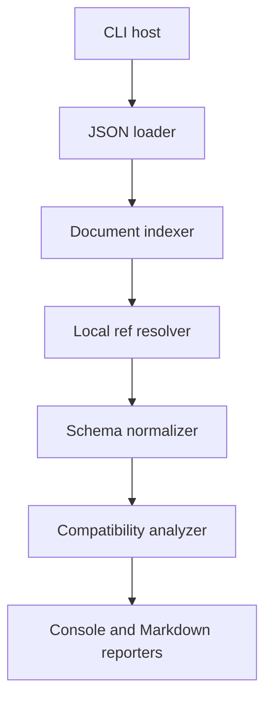
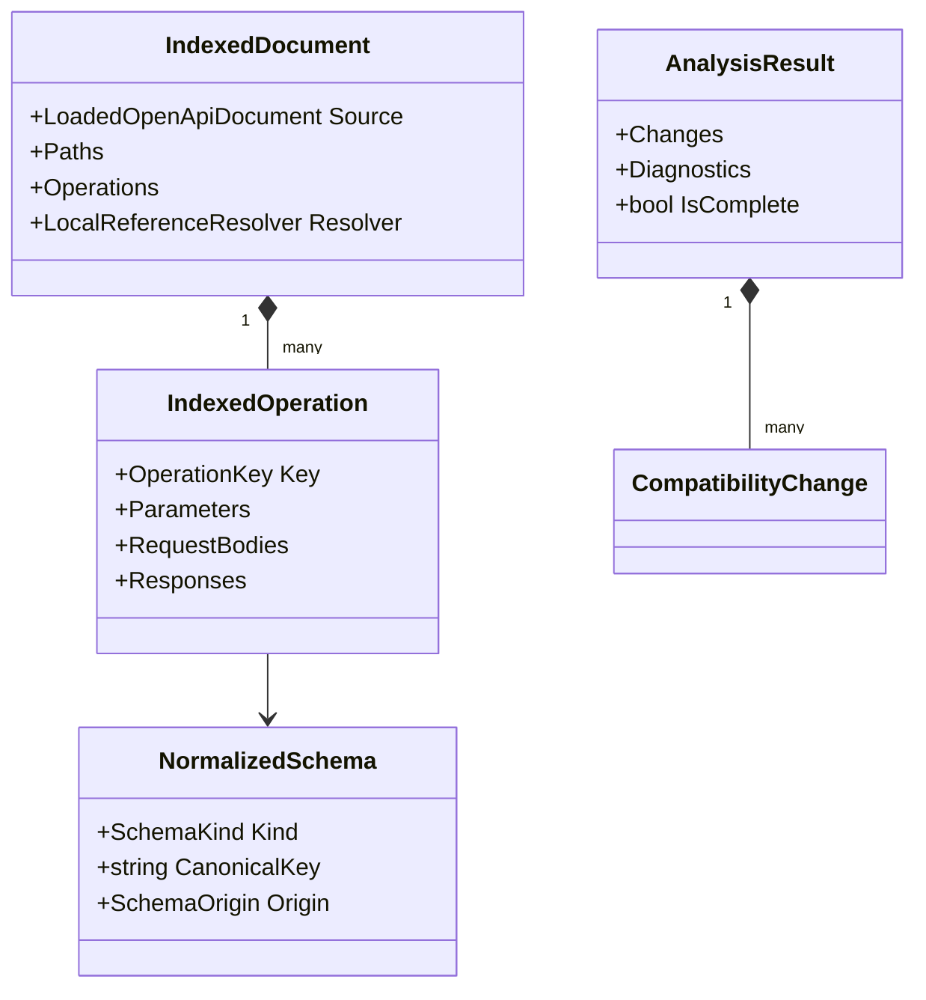

# Architecture

## Design goals

- Correctness for a documented OpenAPI subset.
- Clear rule ownership and explainable findings.
- Deterministic results suitable for source control and CI artifacts.
- Bounded behavior on untrusted, recursive documents.
- A reusable core with a very small CLI surface.

## Component flow



The CLI owns process concerns. The core owns every semantic decision.

## Projects

### `OpenApiBreakingChangeGuard.Core`

Responsibilities:

- Parse a supplied stream or file-independent JSON payload.
- Validate the supported OpenAPI envelope.
- Index operations and schema entry points.
- Resolve local references.
- Normalize schemas.
- Execute compatibility rules.
- Return immutable results and diagnostics.
- Render console-neutral text models or expose results to reporters.

The core must not read environment variables, access the network, call
`Console`, or know GitHub Actions.

### `OpenApiBreakingChangeGuard.Cli`

Responsibilities:

- Parse command-line arguments.
- Open old/new files.
- Select the compatibility profile.
- Call the core.
- Print console output.
- Write Markdown atomically.
- Map outcomes to process exit codes.

### `OpenApiBreakingChangeGuard.Tests`

Responsibilities:

- Fast unit tests for models, refs, normalization, and rules.
- Fixture-driven semantic comparisons.
- Exact-output reporter tests.
- Process-level CLI tests.
- Reduced real-world regressions based on the OpenAI schema.

## Data model



Use API identities rather than raw `JsonElement` paths after indexing.
Retain a source JSON Pointer only for diagnostics.

## Indexing algorithm

For each path entry whose key begins with `/`:

1. Read supported path-level parameters.
2. For every supported HTTP method:
   1. Build `OperationKey(path, normalizedLowercaseMethod)`.
   2. Copy inherited path-level parameters into a map keyed by `(in, name)`.
   3. Overlay operation-level parameters with replacement semantics.
   4. Index request-body content schemas by media type.
   5. Index responses by response key and media type.
3. Do not index arbitrary keys as methods.

Malformed supported fields produce diagnostics. Unknown unsupported metadata is
ignored unless its presence makes a supported decision unsafe.

## Reference resolution algorithm

`LocalReferenceResolver` is document-scoped.

```text
Resolve(reference, activeChain):
  reject if reference does not begin with "#/"
  return cached result if present
  reject if reference is already in activeChain
  reject if depth or unique-reference limit is exceeded
  split reference after '#/' on '/'
  decode each token: ~1 -> /, then ~0 -> ~
  traverse objects by property and arrays by canonical integer index
  cache success or failure
  return target plus canonical pointer
```

The resolver returns a domain result, not `null` plus side effects. A resolution
failure carries a diagnostic code, reference string, and logical location.

Reference cycles are not automatically errors when normalization can represent
recursion symbolically. Detect the cycle, emit a recursive-reference shape, and
continue when possible. A cycle becomes incomplete only if a rule requires an
expansion that cannot be decided symbolically.

## Normalization boundary

Normalization converts JSON syntax into a small schema algebra documented in
`schema-normalization.md`. Each document has its own normalizer, memoized by
`(canonicalPointer, usage)`, so recursive/shared schemas are processed once per
direction.

Do not lose provenance. Each shape retains:

- Logical API location where it was used.
- Canonical source pointer where it was defined.
- Reference chain summary when reached through refs.
- Request or response usage.

## Comparison orchestration

Comparison is hierarchical and suppresses cascades:

1. Compare path sets.
2. For common paths, compare operation sets.
3. For common operations, compare parameters, bodies, and responses.
4. For common schema entry points, recursively compare normalized shapes.

If an ancestor is removed, report the ancestor only. Examples:

- Removed path suppresses removed methods, parameters, and responses below it.
- Removed operation suppresses its removed parameters and schemas.
- Removed property suppresses changes inside that property.
- Removed union alternative suppresses child differences inside that alternative.

This keeps reports actionable and prevents thousands of redundant findings.

## Rule execution

Rules implement a small interface similar to:

```csharp
public interface ICompatibilityRule<TContext>
{
    string RuleId { get; }

    void Evaluate(
        TContext context,
        ChangeCollector changes,
        DiagnosticCollector diagnostics,
        CancellationToken cancellationToken);
}
```

Prefer type-specific rule groups over one reflection-based generic engine:

- Path and operation rules.
- Parameter rules.
- Request/response rules.
- Schema rules.

The analyzer explicitly invokes rules in stable rule-ID order.

## Resource bounds

- File size is checked before parsing when length is known and during copy when
  it is not.
- Use `JsonDocumentOptions.MaxDepth`.
- Avoid recursively materializing referenced JSON trees.
- Use explicit traversal frames if recursive OpenAI schemas approach stack-risk
  levels.
- Collectors stop at their limits and add exactly one limit diagnostic.
- Cancellation is observed regularly in long loops.

## Error model

### Input errors

Unreadable file, invalid JSON, wrong root shape, unsupported OpenAPI major/minor:
exit `2`. No semantic report is considered valid.

### Analysis diagnostics

- Warning: a construct was ignored but documented rules remain reliable.
- Error: at least one compatibility decision may be missing or unreliable.

Any error diagnostic makes the result incomplete and maps to exit `3`.

## Extensibility

New rules should extend indexed/normalized domain types, not inspect random JSON
from reporters. Adding YAML later should introduce another loader that produces
the same indexed representation. Adding SARIF later should consume the existing
analysis result.

